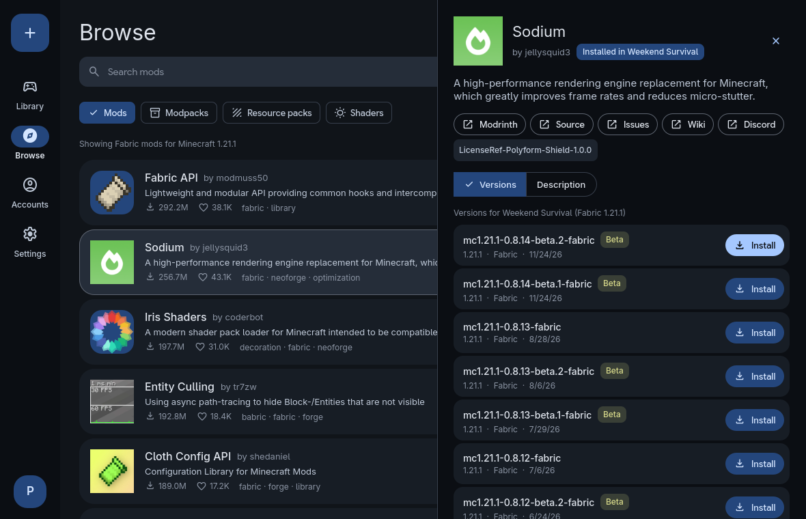

# Lode

A Minecraft launcher for Omarchy. Instances, mod loaders, and mods, resource
packs, shaders and modpacks from Modrinth and CurseForge, in one window that
takes its colors from Tonal and your wallpaper.



## What it does

- **Instances.** Each has its own game version, loader, mods, worlds and
  settings. Libraries, assets and Java are shared, so a second instance of a
  version you have downloads almost nothing.
- **Every loader.** Vanilla, Fabric, Quilt, Forge and NeoForge. Fabric and
  Quilt install from their metadata; Forge and NeoForge run their own
  installer, exactly as the official launcher would.
- **The right Java, automatically.** Each game version gets the Java runtime
  Mojang ships for it (Java 8 for old versions, 21 or 25 for new ones). There
  is nothing to install or pick.
- **Modrinth and CurseForge.** Search mods, modpacks, resource packs and
  shaders, filtered to the instance you're installing into. Required
  dependencies come along. Files you drop in by hand are recognised by hash,
  so they get names, icons and updates too.
- **Updates.** One button checks everything in an instance and updates it,
  moving the old files to the trash.
- **Modpacks.** Install from either site, open a `.mrpack` or CurseForge
  `.zip` (`lode pack.mrpack`), or drop one on the window.
- **Accounts.** Microsoft sign-in with a device code, plus offline names for
  singleplayer and offline-mode servers.
- **Quick.** Native Qt Quick, no web view. Lists recycle their rows, images
  decode off the UI thread and are cached on disk, and a game's log is fed to
  the view in batches.

## Setting up

Lode works for offline play and Modrinth straight away. Two services need
keys that only you can register, and both go in Settings:

**Microsoft sign-in.** Minecraft accounts sign in through an Azure app:

1. Register an app at <https://portal.azure.com> → *App registrations*,
   for *personal Microsoft accounts only*.
2. Under *Authentication*, turn on *Allow public client flows*.
3. Ask Mojang to allow it at <https://aka.ms/mce-reviewappid>. Until they
   approve it, sign-in stops with a message saying so.
4. Paste the *Application (client) ID* into Settings.

**CurseForge.** Get a free API key at <https://console.curseforge.com> and
paste it into Settings. Some CurseForge authors don't allow third-party
downloads; Lode lists those files with a link and the folder they belong in,
rather than skipping them.

## Shortcuts

| Key | Does |
| --- | --- |
| Space | Play the selected instance |
| Ctrl+N | New instance |
| / or Ctrl+F | Search mods and packs |
| 1 – 4 | Library, Browse, Accounts, Settings |
| Enter | Open the highlighted result |
| Esc | Back, or close what's open |
| ? | Show every shortcut |
| Q | Quit |

## From the command line

```sh
lode list --json
lode create "Weekend Survival" --minecraft 1.21.1 --loader fabric
lode prepare "Weekend Survival"   # download everything, don't start
lode launch "Weekend Survival"
lode skill install                # teach Claude to drive it
```

Each command exits 0 on success, or 1 with the reason on stderr.

## Where things live

- `~/.local/share/lode/instances/<name>/minecraft`: each game folder
- `~/.local/share/lode/{libraries,assets,versions,java}`: shared downloads
- `~/.local/share/lode/accounts.json`: sign-in tokens, readable only by you
- `~/.config/lode/config.json`: settings

`LODE_HOME` moves all of it, for a test setup.

## Building

```sh
bin/build     # build/lode
bin/test      # unit tests, offscreen
bin/install   # package with makepkg and install, so it shows up in the launcher
```

Needs Qt 6 (base, declarative, wayland) and `bsdtar` from libarchive. With
Tonal installed, Lode uses its Google Sans Flex and Material Symbols fonts;
without them it falls back to the desktop font and plain symbols.

## Not yet

- Updating a modpack instance to a newer pack version
- Importing instances from Prism Launcher or the official launcher
- Skins and capes
- Forge before 1.13, whose installers can't run unattended
